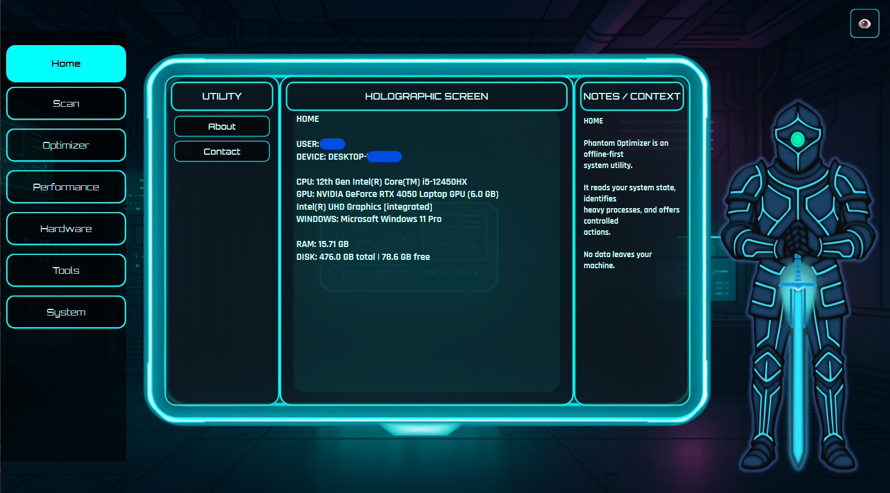

# Phantom Optimizer V2

**Offline-first Windows system utility.** Scan, optimize, and benchmark your
machine from a single holographic HUD. No accounts, no telemetry, no network
calls. Your data never leaves your computer.



---

## What it does

Phantom Optimizer is a desktop control panel for Windows with seven modules,
each focused on a specific layer of the system:

| Tab | Purpose |
|---|---|
| **Home** | System snapshot — username, device, CPU, GPU, Windows version, RAM, disk |
| **Scan** | Four scan modes with health verdicts and exportable reports |
| **Optimizer** | Process inventory with protected-process detection, kill and whitelist |
| **Performance** | CPU, disk, memory, and GPU benchmarks with live thermal guards |
| **Hardware** | Read-only inventory of CPU, motherboard, GPU, RAM, disks, network, audio, monitors, USB, sensors |
| **Tools** | Startup manager, temp cleaner, event log viewer/export, network usage |
| **System** | Power plans, privacy toggles, update pause, safe mode, shutdown/restart |

Every action is either read-only or explicitly confirmed. No background
services, no scheduled tasks, no registry writes without a dialog.

---

## Highlights

### Three themes, live switching
Cyan **Default** (animated character), petrol-blue **Dark**, grayscale **Light**.
The eye button in the top-right cycles them. The character animation pauses in
Dark and Light to save CPU.

### Four scan modes
- **Full** — deep system scan with a health verdict (OK / WARN / FAIL per category)
- **Phantom** — fast CPU/RAM/Disk snapshot
- **Software** — installed applications with publisher and version
- **Hardware** — full hardware inventory

Scans can be cancelled after 5 seconds. Full reports can be saved.

### Optimizer with protected-process detection
The optimizer identifies user processes, background apps, and system-critical
processes (marked `CRITICAL`). The termination backend rechecks the current process name and system/user
whitelists immediately before acting; it does not rely solely on the UI tag.
A whitelist file (`whitelist.txt`, stored under `%APPDATA%\PhantomOptimizer\`)
excludes matching process names from termination.

### Honest benchmarks
- **CPU** — 0.5s warmup, 2s single-thread, 2s multi-thread, jitter and stability
  reported. Thermal gates abort at 90°C.
- **Disk** — 256 MB sequential write/read plus 50 × 4 KB small-file IOPS.
  Writes are flushed with `fsync`; sequential reads may be served from the
  Windows file cache, so they are not guaranteed uncached device measurements.
  IOPS are calculated from successfully completed file operations.
- **Memory** — sampled multi-pattern check over a 512 MB allocation
  (0x00, 0xFF, 0xAA, 0x55, ramp). It samples one byte per 4 KiB by default;
  it is a lightweight check, not a full RAM diagnostic or a MemTest86 replacement.
- **GPU Pulse** — Mandelbrot fill rate + ALU throughput, with a live preview window.
  Thermal abort at configurable threshold. Requires PyOpenGL.

### Thermal safety
Every benchmark checks temperature before and during the run. Hot hardware is
refused, not stressed. Live monitor shows CPU/GPU/RAM/Disk continuously and
pauses while a benchmark is active.

### One-file portable exe
Ships as a single `PhantomOptimizer.exe` (size varies by release/build). No
Python install is required on the target machine. UAC elevation is requested
automatically on first launch.

---

## Requirements

- **Windows 10 or 11, 64-bit**
- **Administrator privileges** — the app self-elevates via UAC
- **Python 3.10+** (source only, not required for the exe)

## Run from source

```bat
git clone https://github.com/glorythearchitect/Phantom_Optimizer_V2.git
cd Phantom_Optimizer_V2
pip install -r requirements.txt
python main.py
```

The first launch triggers a UAC prompt. This is expected — Phantom Optimizer
needs elevation for SMART disk reads, WMI hardware queries, event log access,
and power plan changes.

## Download the exe

Grab `PhantomOptimizer.exe` from the
[Releases page](https://github.com/glorythearchitect/Phantom_Optimizer_V2/releases).

**Note on SmartScreen**: the exe is not code-signed. Windows may show
"Windows protected your PC" on first run. Click **More info → Run anyway**.
Signing costs $100–400/year — for an open-source tool, the warning is the
honest tradeoff.

## Build the exe yourself

```bat
pip install -r requirements.txt
pyinstaller phantom_optimizer.spec --noconfirm
```

Output: `dist\PhantomOptimizer.exe`. First build takes 2–5 minutes.

---

## Project layout

```
phantom_optimizer/
├── main.py                     entry point — UAC, QApplication, font loading
├── phantom_optimizer.spec      PyInstaller build spec
├── requirements.txt
├── README.md
├── LICENSE
│
├── app/                        all Qt code
│   ├── ui/
│   │   ├── theme.py            palettes, QSS builders, frame geometry
│   │   ├── widgets.py          custom QWidget / QDialog / QFrame classes
│   │   └── scene.py            PhantomScene — main window, controller wiring
│   ├── controllers/            per-tab controllers (Qt signals, worker threads)
│   └── gpu_test_ui.py          GPU Pulse confirmation + live preview
│
├── core/
│   ├── configs.py              tunable thresholds (thermal, durations, limits)
│   ├── paths.py                frozen-safe path resolution (APPDATA, temp, assets)
│   └── threads.py              worker pool for off-GUI-thread operations
│
├── system/                     admin, power, privacy, updates, safe mode, shutdown
├── hardware/                   CPU/GPU/RAM/disk/network/sensor/event-log readers
├── optimizer/                  process scan, killer, whitelist, memory tools
├── performance/                CPU/disk/memory/GPU benchmarks, live monitor
├── maintenance/                cleaner
├── shutdown/                   safe shutdown and restart helpers
│
└── assets/
    ├── app_icon.ico
    ├── fonts/                  Orbitron-Bold, Rajdhani-{300..700}
    └── harvester/              character layers + theme backgrounds/frames
```

### UI split

The UI is deliberately **three files**, not one:

- **`theme.py`** owns every color, font size, QSS string, and layout constant.
  Change a theme by editing one file. Nothing else knows about colors.
- **`widgets.py`** owns every custom widget class. Widgets draw; they don't
  decide palettes — they receive a `palette_getter` callable.
- **`scene.py`** owns `PhantomScene` — the main window, controller wiring,
  tab lifecycle, and theme application. It imports from `theme` and `widgets`,
  never the other way around.

This split exists because the pre-refactor monolith made every theme fix cascade
into a new bug. If you're contributing, **respect the direction of imports**:
`theme ← widgets ← scene`. Circular imports here are fatal.

---

## Configuration

Tunable thresholds live in `core/configs.py`:

| Constant | Meaning | Default |
|---|---|---|
| `GPU_TEST_TEMP_WARN_C` | GPU benchmark refuses to start above this temp | 85 °C |
| `GPU_TEST_TEMP_ABORT_C` | GPU benchmark aborts mid-run above this temp | 90 °C |
| `GPU_TEST_DURATION_S` | Total GPU Pulse duration | 8 s |
| `GPU_TEST_GPU_USE_WARN_PCT` | Warn in dialog if GPU already > N% utilized | 10 % |
| `WHITELIST_FILE` | Filename of the process whitelist | `whitelist.txt` |

CPU and disk test thresholds are documented inline in their test modules
(`performance/cpu_test.py`, `performance/disk_test.py`).

## Where Phantom Optimizer writes files

| File | Location (source) | Location (frozen exe) |
|---|---|---|
| `whitelist.txt` | `<project root>` | `%APPDATA%\PhantomOptimizer\` |
| Report exports | `%USERPROFILE%` (File dialog default) | Same |
| Disk test temp | `%TEMP%\phantom_disk_test.tmp` | Same |
| GPU test tmp | In-memory (no file) | Same |

Nothing is written to the repo, to Program Files, or to the registry unless you
explicitly confirm a Privacy / Power / Startup action.

---

## Safety notes

### GPU Pulse
Runs the GPU under sustained load for ~8 seconds. The confirmation dialog lists
temperature limits and refuses to start if the GPU is already hot. **Do not run
on battery.** Close other GPU-heavy applications first.

### Process kill
Every kill action asks for confirmation and lists the selected PIDs and names.
The backend independently blocks PID 0, PID 4, the optimizer itself, and names
in the built-in or user whitelist. It also rechecks the PID/name identity before
termination so a stale process-list entry is rejected.

### Cleanup
Cleanup removes contents of configured temporary/cache targets, not the target
directories themselves. Firefox profile directories and the broad Windows Logs
directory are deliberately excluded; browser profile data must never be treated
as disposable cache.

### Safe Mode
Entering Safe Mode reboots the machine. Exit instructions are shown in the
confirmation dialog and re-printed in the Safe Mode tab if the app is relaunched
there. Manual fallback is documented in the dialog for the case where the app
cannot start under Safe Mode.

### Shutdown / Restart
5-second delay via `shutdown /t 5`. Pending shutdowns can be cancelled with
`shutdown /a` from the Cancel Pending button.

### UAC elevation
Phantom Optimizer requests administrator privileges at launch. Without elevation,
`hardware/disks.py`, `hardware/event_logs.py`, `system/power.py`,
`system/privacy.py`, and `system/windows_update.py` would fail with
`Access Denied`. The tradeoff is one UAC prompt per launch vs. broken features.

---

## Contributing

Contributions are welcome. Before opening a PR:

1. **Read the `theme ← widgets ← scene` rule above.** Most PR failures are
   caused by importing `scene` from `widgets` and getting circular imports.
2. **Test all three themes after any UI change.** The eye button cycles them.
3. **Test the frozen build after any backend change.** Frozen is where
   `sys.executable`, `_MEIPASS`, and relative paths behave differently.
   `pyinstaller phantom_optimizer.spec --noconfirm` takes 3 minutes.
4. **Match the existing style.** No new dependencies without a reason in the
   PR description. No reformatting unrelated files.

## Development notes

### Why the subprocess patch exists
`main.py` monkey-patches `subprocess.Popen` and `os.system` when `sys.frozen` is
true, forcing `CREATE_NO_WINDOW` and hidden `STARTUPINFO`. Without this, every
`powercfg`, `bcdedit`, `wmic`, and `wevtutil` call inside the frozen exe flashes
a cmd window. Do not remove this patch — it's not cosmetic, it's the difference
between a professional-looking app and a fire of shell windows.

### Why `win32timezone` is in the spec's hidden imports
`wmi` imports it lazily on first query. PyInstaller does not pick this up
automatically. Without `hiddenimports += ["win32timezone"]`, the exe launches
fine, then crashes on the Home or Hardware tab with `ModuleNotFoundError`.
This is a known PyInstaller + pywin32 issue.

### Why the whitelist lives in APPDATA in frozen mode
`_MEIPASS` is a temp folder created fresh on each exe launch and deleted on
exit. Writing user data there means it's gone next session. `core/paths.py`
detects `sys._MEIPASS` and routes writable data to `%APPDATA%\PhantomOptimizer\`.

---

## License

MIT — see [LICENSE](LICENSE).

Bundled fonts:
- **Orbitron** -
- **Rajdhani** -

No ownership has been taken for the fonts.

---

## Credits

**Author**: Sobhan Salmani Soula AKA Glory The Architect

**Built with**: Python 3.11 · PyQt6 · psutil · PyOpenGL · pywin32 · WMI

**Third-party libraries**: see `requirements.txt`. All are permissively licensed
(MIT / BSD / PSF / SIL OFL). No GPL code is bundled.
